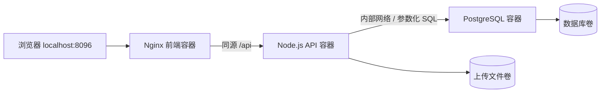

# 校园课程共享平台：完整容器部署与实验

## 目标与架构

借鉴课程资料共享项目的课程目录、版本记录和维护流程，以及课程评价系统的网页、应用、数据库分层，在本项目实现独立容器部署。界面和业务逻辑使用本项目代码，没有复制其他平台的学生点评或个人信息。



线上公开站点继续采用 GitHub Pages、Workers、D1 与 R2。容器版是独立运行与课程实验方案，使用独立数据库、文件卷和管理密钥；没有把线上数据库迁移到学生电脑，也不需要电脑开机来维持原线上站点。

## 前端与后端

- 前端：课程搜索、资料分类、教师学期筛选、预览、投稿恢复与维护页面。Nginx 向容器版注入同源 API 地址，避免网页可打开而远程投稿服务不可达的组合问题。
- 上传体验：XHR 显示实际传输进度，上传到 100% 后显示“正在保存”，后端确认保存成功后才提示完成。失败保留表单与文件以便重试。
- 后端：`server/domain.mjs` 提供课程、经验、上传、反馈与管理接口；`runtime.mjs` 接入 PostgreSQL 和文件存储。SQL 使用参数绑定；修改操作带版本检查；修改权限采用设备凭据哈希，反馈详情仅维护者可读。
- 上传：Nginx 关闭请求缓冲，API 使用流式 multipart 解析和临时文件，将数据流写入文件卷，避免先把整个上传文件读入 JavaScript 内存。保留文件类型验证和应用总存储空间检查。
- 数据库：版本化 SQL 迁移，启动时事务执行并核对迁移校验和；连接池管理连接。

## 容器技术对应

| 技术 | 本项目中的证据 |
|---|---|
| 镜像构建 | 根目录 `Dockerfile` 与 `server/Dockerfile` |
| 多服务编排 | Compose 同时定义 web、api、db |
| 端口映射 | 只公开网页端口，内部 API 和数据库不发布宿主机端口 |
| 网络隔离 | web 与 api 在前端网络；db 只在内部后端网络 |
| 持久化 | `postgres_data`、`uploaded_files` 命名卷 |
| 健康与启动顺序 | 数据库就绪后启动 API，API 健康后启动网页 |
| 私有配置 | 自动生成 `.env.container`，不提交密钥 |
| 最小权限 | API 以 node 非 root 用户运行 |
| 故障恢复 | 重启策略、优雅关闭、数据库与文件联合备份 |

## 一键运行

```sh
npm run container:up
docker compose --env-file .env.container ps
```

默认访问 http://localhost:8096。先备份 `.env.container`；其中的容器管理密钥仅用于本地版。新部署自动创建数据库结构，但不会导入线上后来新增的投稿和 R2 文件。原有课程索引和旧操作系统经验作为只读种子提供。

## 已完成的实际验证

在隔离的 `kejian-course-lab` 项目中运行：

1. 课程、经验增改，文件上传下载、类型检查、权限隔离、版本冲突测试。
2. 分类和教师学期信息持久化，私人反馈、维护者处理和核实测试。
3. 创建演练课程与文件，生成数据库和文件一致性备份。
4. 强制重建 web、api、db 三个容器，确认课程、文件字节和投稿修改权限保留。
5. 删除演练数据，再恢复数据库与文件备份，确认原 ID、修改权限及文件字节恢复。

演练输出位于本机 `artifacts/stack-drill-result.json`，备份在对应的 `artifacts/stack-backup-*` 目录。这些实验产物不提交仓库；可通过 `npm run container:drill` 重现。演练结束会清理自己的测试投稿。

## 备份与恢复

```sh
npm run container:backup
node scripts/stack-backup.mjs restore backups/某次备份 --replace
```

备份短暂停止 API，依次导出 PostgreSQL 和文件卷，写入校验清单后启动服务。恢复会替换目标项目数据，先备份当前状态。不要把元数据 JSON 快照当成完整文件备份，不要对日常使用中的项目运行破坏性演练，也不要用 `down -v` 清除数据卷。

## 答辩建议

展示网页和上传进度；打开 Compose 说明三层结构；查看三个健康容器；创建一条演练数据，重建容器后再次查看；最后展示备份校验和恢复结果。若课程还要求虚拟机实验，可在 Linux 虚拟机中运行同一套 Compose，另行展示虚拟机网络和资源配置；本次未宣称完成虚拟机部署。

## 参考

- [USTC 评课社区开源代码与部署说明](https://github.com/USTC-iCourse/ustc-course)
- [浙江大学课程攻略共享计划](https://github.com/QSCTech/zju-icicles)
- [Docker Compose 启动顺序](https://docs.docker.com/compose/how-tos/startup-order/)
- [node-postgres 参数化查询](https://node-postgres.com/features/queries)
